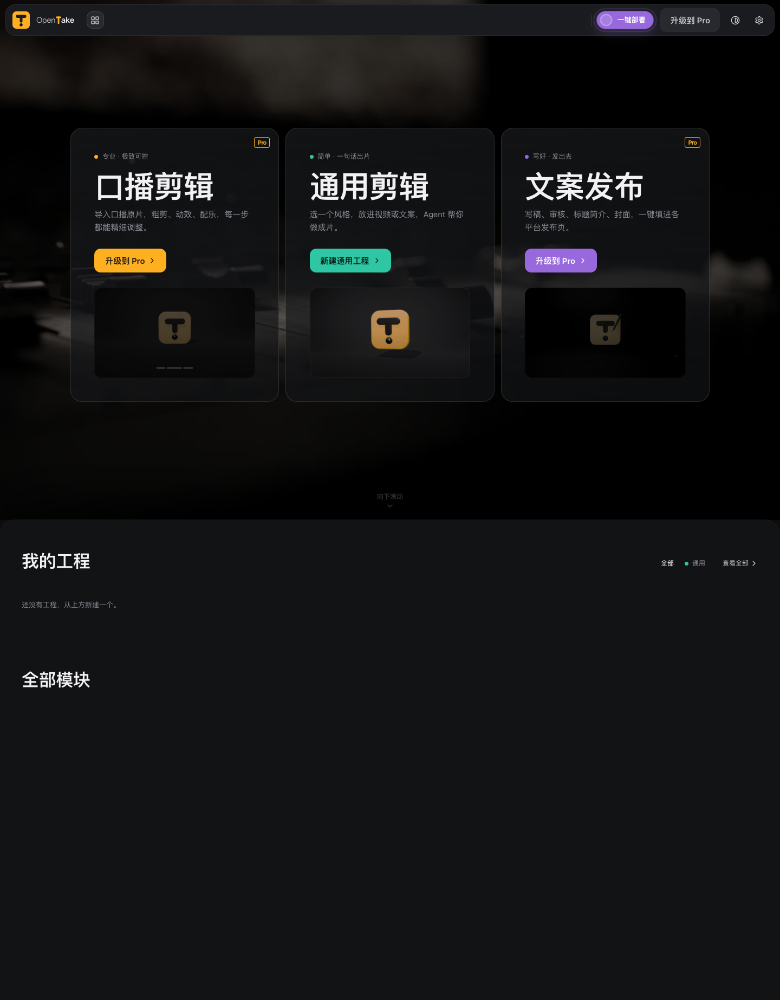
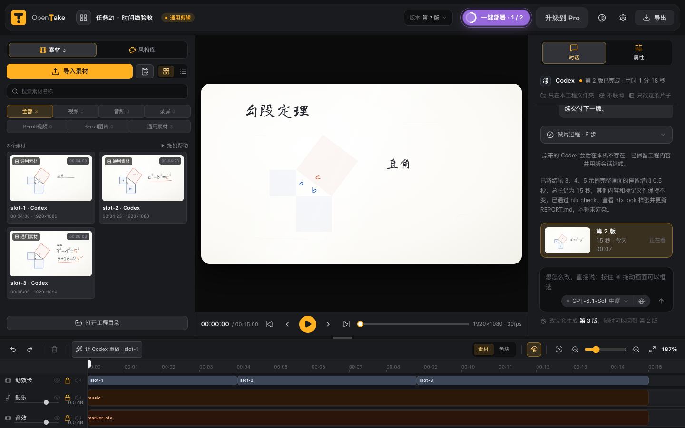
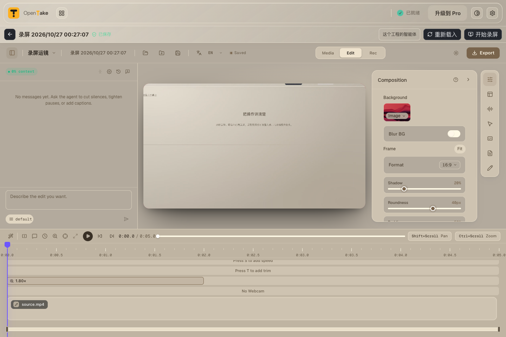

# OpenTake Standard

免费的本地视频工具：通用剪辑与录屏运镜。编辑不需要 OpenTake 账号；出片可接入 Codex 或 Claude Code 命令行，并支持 API 密钥方式（仍需对应命令行执行出片）；Claude Code 默认关闭。只有 API 密钥、没装命令行时只能做轻量文字任务。Pro 功能不包含在本仓库。

## 下载安装

| 系统 | 安装包 |
| --- | --- |
| **Windows 10 / 11（64 位）** | **[下载 EXE（628 MB）](https://github.com/saf1102/opentake-standard/releases/download/desktop-v1.1.2-2026110901/OpenTake-Standard-Setup-1.1.2-x64.exe)** |
| **Mac（Apple 芯片，M1 及以后）** | **[下载 DMG（434 MB）](https://github.com/saf1102/opentake-standard/releases/download/desktop-v1.1.2-2026110901/OpenTake-Standard-1.1.2-mac-arm64.dmg)** |
| **Mac（Intel 芯片）** | **[下载 DMG（395 MB）](https://github.com/saf1102/opentake-standard/releases/download/desktop-v1.1.2-2026110901/OpenTake-Standard-1.1.2-mac-x64.dmg)**（[测试范围](#intel-mac-测试范围)） |

下载后直接安装，不用自己编译。其他版本和校验值见 [Releases](https://github.com/saf1102/opentake-standard/releases)。

安装包暂未做苹果公证和 Windows 代码签名，第一次打开时系统会拦一下：

- **Mac**：提示无法验证开发者时，打开「系统设置 → 隐私与安全性」，在下方找到 OpenTake Standard，点「仍要打开」。
- **Windows**：出现「Windows 已保护你的电脑」时，点「更多信息」，再点「仍要运行」。

**Windows** 安装包已带齐运行工具，装好后在设置里接通智能体就能用。

**Mac** 安装包暂时不带运行工具。先从 [nodejs.org](https://nodejs.org) 安装 Node.js 24（一键更新也要用），再在第一次出片前到终端运行一次（需要已安装 [Homebrew](https://brew.sh)），也可以把这段发给你的智能体执行：

```sh
brew install ffmpeg python
python3 -m venv "$HOME/.opentake-venv" && "$HOME/.opentake-venv/bin/python3" -m pip install numpy
npx --yes playwright-core@1.63.0 install chromium
```

软件里如果提示「在 Standard 源码目录运行」安装 Chromium，用上面第三条命令即可，不需要源码目录。智能体在「设置 → 智能体接入」里接通。录屏运镜还需要安装官方 OpenScreen，见[从源码安装](#从源码安装macos--apple-芯片与-intel)里的说明。

想自己构建，或者想看源码：[下载官方源码 ZIP](https://github.com/saf1102/opentake-standard/releases/latest/download/OpenTake-Standard-source.zip) · [核对 SHA-256](https://github.com/saf1102/opentake-standard/releases/latest/download/OpenTake-Standard-source.zip.sha256)，步骤见[从源码安装](#从源码安装macos--apple-芯片与-intel)。

[每日下载统计](https://github.com/saf1102/opentake-standard/tree/repository-stats)显示的是请求次数，不是用户人数或安装成功数，App 不上报使用遥测。[统计口径](DOWNLOAD-STATS.md)

已经在用源码版的 Mac 用户不需要重装，软件内的更新照旧。**1.0.0 用户请对智能体说：按 AGENTS.md 更新到最新版。** 1.0.0 没有更新提醒；从 1.0.1 开始每天检查。

## 1.1.3 更新

OpenTake 1.1.3

软件内更新
- **用安装包装的 Mac 用户：这一次请到下载页面手动下载 1.1.3 安装包替换旧版**，以后就能在软件里一键更新。
- Mac 一键更新改为直接换官方安装包，核对校验码后替换 App，新版启动不起来自动换回旧版；不再需要 Node、Python。
- Windows 在软件里下载安装程序，静默安装到原来的位置，装完自动打开新版。
- Mac 和 Windows 都直接从 GitHub 检查新版本，GitHub 打不开时改用备用地址。
- 修复源码版升级后下一次无法一键更新的问题。

## 1.1.2 更新

OpenTake 1.1.2

通用剪辑
- 新增「不用风格，直接开始」：新建通用剪辑时可以不套风格，用一段话说清要做什么，再放视频、图片和音乐，画面、字体、配色、节奏都按你的话来定。Mac 和 Windows 都有。
- 「不用风格」的输入框可以直接把素材拖进去，拖到上面会亮起描边；不是视频、图片、音乐的文件会提示没放进来。
- 修复 Windows 上部分视频拖不进去或选不出来：`.mov`、`.mkv`、`.avi` 等格式在一些电脑上系统认不出类型，以前会被悄悄丢掉，现在按扩展名判断。

## 1.1.1 更新

OpenTake 1.1.1

智能体
- DeepSeek Harness（`dsh`）现在可以用来出片，它里面配置的千问等其他模型也能用。这是新支持的接法，遇到问题请反馈。
- DeepSeek 卡片的 API 密钥只能处理纯文字，界面会写明；只有 API 密钥也要出片时，可以在 Codex 的 API 密钥里点「填入官方地址」接 DeepSeek。
- CodeBuddy 没登录时说清楚原因：只用自己的模型（models.json）也要先登录；Windows 上也可以设置环境变量 `CODEBUDDY_API_KEY`。
- 接口地址填错不再直接失败：多填的 `/v1/messages`、`/responses`、`/chat/completions` 等路径会自动去掉，已保存的地址也一样。
- 兼容更多中转站：没有模型列表或 token 计数接口时，手动填写模型后会发一次最小请求来确认，消耗极少量额度。接口不存在时，报错会写明实际请求的地址。
- 修复 Windows 上 Chromium 检查偶尔报 `EPERM` 导致无法渲染（[#2](https://github.com/saf1102/opentake-standard/issues/2)）。

## 1.1.0 更新

OpenTake 1.1.0

智能体
- 本次修复：Windows 可识别和手动选择 `.cmd` / `.bat` 智能体程序，支持含空格和中文的路径；DeepSeek Harness 命令行出片仍待适配。
- 修复第三方 Responses 接口的连接测试；需要回退验证时会发送一次最小请求，消耗极少量额度，并在结果中说明。
- 出片、复查和文字任务跟随接入设置的模型；第三方服务没有默认模型时，会提示先选择模型。
- 自动找到电脑上装好的智能体，登录好的直接接通；没登录的，点「登录」在终端里登好就自动接上。
- 接通的智能体都能拿来出片，可以在 Codex、Kimi、MiniMax Code 等之间切换；出片中途失败，可以换一家从当前进度接着做。
- 设置里可以换账号、看到智能体版本过旧的提醒，还能对比各家的出片用时和用量。

剪辑
- ⌘ 点击时间线上的素材，弹出圆盘，变速、音量、淡入淡出、改字、复制、删除都在片段上完成。
- 片段可以变速（0.1× 到 100×），预览可以 2×、4× 播放，也能放大看细节。
- 复制粘贴会落在鼠标所在的轨道和播放头位置；淡入淡出和音量直接在片段上拖。

通用剪辑
- 时间线可以直接改：拖动、裁剪、复制、删除画面和声音，每条轨道可以单独隐藏。
- 字幕一句一条，音效一声一段；挪动画面时，配音和音效跟着走。旧片子打开时会自动把混在一起的音效按声音切开。
- 配音、配乐、音效轨显示波形。
- 动效卡可以变速：按住 ⌥ 拖右边缘，整段动画加快或放慢，完整播完。
- 「打开工程目录」可以用了。

导出
- 导出到剪映时，字幕是剪映自己的字幕，可以直接在剪映里改。

已知项：API 密钥连通未实测（没有密钥）。

## 界面预览

首页：



通用剪辑出片与时间线：



录屏运镜：



截图来源和版本见 [截图记录](screenshots/README.md)。截图不代表每种智能体都已真实出片。

## Standard 和 Pro

| 能力 | Standard | Pro |
| --- | --- | --- |
| 通用剪辑：不用风格 / 上传视频 / 给文案 | 有 | 有 |
| 风格库 | 九类全列，五类十种可用，其余显示 Pro | 完整风格库 |
| 录屏运镜、时间线、成片导出 | 有，另装 OpenScreen | 有，另装 OpenScreen |
| 统一智能体接入 | 共用；仅显示通用剪辑、录屏相关接入 | 共用，另有创作服务接入 |
| Claude Code | 默认关，需用户启用；可用 API 密钥 | 同样默认关 |
| 口播剪辑、动效库、链接读取 | Pro 介绍入口 | 有 |
| 文案发布、选题、运营分析 | Pro 介绍入口 | 有 |
| 安装与更新 | 公开源码，本机构建 | 桌面应用与更新服务 |
| 使用账号 | 编辑不需 OpenTake 账号 | 需要授权 |

在应用中点「升级到 Pro」查看当前开放状态与申请方式。申请不会自动购买或替换本机应用。

## 智能体接入

设置 → 智能体接入，统一选择「命令行 · 账号登录」或「API 密钥」。密钥只存 macOS 钥匙串；地址与密钥仅在启动本次智能体时传入，不改 `~/.codex`、`~/.claude`。第三方接口以亮紫提醒，测试通过后可以使用。Codex API 必须兼容 OpenAI Responses，Claude Code API 必须兼容 Anthropic。

Claude Code 默认关闭。订阅账号方式开启前有风险确认，推荐 API 密钥。未适配的命令行或接口明确显示「待适配」；没有命令行的 API 接入不能出片。真实接入结果以本机「测试连接」为准；任务验收仅让 Codex 命令行真实出片；所有 API 密钥方式（包括 Codex）只检查连通，不运行任务。

## English

OpenTake Standard is a local video editor for general creation and screen-recording motion. Download the [Windows installer](https://github.com/saf1102/opentake-standard/releases/download/desktop-v1.1.2-2026110901/OpenTake-Standard-Setup-1.1.2-x64.exe), the [Intel Mac DMG](https://github.com/saf1102/opentake-standard/releases/download/desktop-v1.1.2-2026110901/OpenTake-Standard-1.1.2-mac-x64.dmg), or the [Apple Silicon Mac DMG](https://github.com/saf1102/opentake-standard/releases/download/desktop-v1.1.2-2026110901/OpenTake-Standard-1.1.2-mac-arm64.dmg), or use the [Intel Mac DMG placeholder](#intel-mac-测试范围) pending acceptance. Build from source on an Apple Silicon or Intel Mac with `npm run setup` and open with `npm start`. Agent connections support CLI accounts and API keys; film generation requires a supported CLI. Claude Code is off by default. Pro-only publishing, talking-head and analytics modules are not included.

### Intel Mac 测试范围

Intel 版已在 GitHub 的 Intel 机器上通过全部自动测试和打包，并在 M 芯片 Mac 上用 Rosetta 实测了启动、打开工程、导出、取消和重启。还没有在 Intel 真机上测试过，录屏和老机型的硬件编码可能有差异；HEVC 导出不可用时，软件会提示改选 H.264 或 ProRes。

The Intel build passes the full automated tests and packaging on GitHub's Intel runner, and was exercised under Rosetta on an Apple Silicon Mac (launch, open project, export, cancel, restart). It has not been tested on real Intel hardware; recording and hardware encoding on older models may differ.

## 许可与隐私

源码使用 AGPL-3.0，详见 LICENSE；OpenTake 名称与图标的使用边界见 TRADEMARK.md。默认不采集使用行为，公开更新检查可在设置中关闭。工程保存在本机；使用智能体或第三方接口时，任务内容会发送给你选择的提供方。

## 从源码安装（macOS / Apple 芯片与 Intel）

对你的智能体说：**按这个仓库的 AGENTS.md 帮我装好 OpenTake Standard。**

先安装 Node.js 24.15.0 或更新的 24.x（含 npm）、Python 3 和 FFmpeg / ffprobe；setup 会准备独立 numpy 环境。生成视频还需要安装支持出片的智能体命令行，并在设置中完成接入。录屏运镜的录制和导出需要另外安装官方 OpenScreen 2.1.2 或兼容版本，见下节。不要用 sudo，也不要关闭系统安全保护。

```sh
# 将官方源码 ZIP 解压后，进入源码目录
cd opentake-standard
npm run setup
npm run typecheck
npm test
# 在设置中接通智能体以后，再检查出片环境
npm run doctor
npm start
```

也可以用 Git 获取源码：`git clone https://github.com/saf1102/opentake-standard.git`，然后进入目录执行上面的安装步骤。已有 Git 工作目录可继续按 Git 更新；ZIP 快照不会包含 Git 历史。

`setup` 适用于 macOS 12+ / Apple 芯片与 Intel x64（锁定 Electron 的最低系统版本；实际工具检查仍须通过），需要至少 8 GB 可用空间。它检查系统和 Node、执行两次 `npm ci`、安装匹配的 Playwright Chromium，在 `~/.opentake-venv` 准备 Python + numpy，并用 `build:live` 构建。失败会用中文说明并以非零退出码结束；修好后可重复运行，已完成且依赖完整的安装会跳过。缺少 FFmpeg 时只提示，不自动下载。OpenScreen 可选，不阻断通用剪辑安装。

手动步骤仍可使用：

```sh
npm ci
npm --prefix vendor/openscreen ci --ignore-scripts
npx --no-install playwright-core install chromium
python3 -m venv "$HOME/.opentake-venv"
"$HOME/.opentake-venv/bin/python3" -m pip install numpy
npm run typecheck
npm test
npm run build:live
```

两个 `npm ci` 都是必要步骤。第二个只安装内嵌编辑器的前端构建依赖，不编译 OpenScreen 原生合成器。`npm run build` 生成录屏编辑器资源；不能只装根目录依赖就直接启动。浏览器由锁定版本的 Playwright 从官方源安装。

日后在此目录运行 `npm start` 打开桌面窗口；`npm run dev` 仅启动网页开发服务。

### 生成本机 App

完成上面的安装后运行 `npm run build:app`，在 `release/` 下得到经过本机临时签名、严格验签且已清理隔离标记的 `OpenTake Standard.app`。先在该位置双击验收，再自行拖到「应用程序」；已有同名 App 时先确认，不覆盖已有工程。此命令不生成安装包、不发布，也不包含媒体工具；FFmpeg、Python、Codex、OpenScreen 仍需在本机可用。

### 缺少工具时

- Node.js：从 [Node.js 官方站点](https://nodejs.org/) 安装 24.15.0 或更新的 24.x，重新开终端确认 `node --version`。
- FFmpeg：确认 `ffmpeg -version` 和 `ffprobe -version` 都成功。Standard 不分发 FFmpeg 二进制；请使用合适许可的构建。需要手动指定时，把含这两个程序的目录设为 `LINKREADER_BIN_DIR`。
- Python：确认 `python3 -c "import numpy"` 成功。缺 numpy 时可建立项目自己的虚拟环境：`python3 -m venv .venv`，再运行 `.venv/bin/python -m pip install numpy`；启动前将 `LINKREADER_PYTHON` 设为该解释器的绝对路径，不改系统 Python。
- Chromium：再次运行上面的 Playwright 安装命令；不要使用另一版本的缓存替代。
- OpenScreen：按下一节从官方发布页安装。没有它仍可使用通用剪辑。
- 网络失败：保留目录，网络恢复后重试失败的安装步骤。不要跳过失败步骤后声称安装完成。

测试或并行安装可显式设置 `OPENTAKE_STANDARD_USER_DATA`（配置目录）及 `LINK_READER_PROJECTS_DIR`（工程目录），都使用独立绝对路径。默认工程目录是 `~/Movies/LinkReader Projects`，卸载程序时不要删除工程目录。

## Recording and OpenScreen export

Install OpenScreen separately. Standard discovers `openscreen` on PATH, the macOS Applications folders, or an explicit `OPENSCREEN_BIN` executable. The tested official release is 2.1.2 (macOS arm64); its official Intel download exists, but Intel recording/export acceptance is pending. Official 1.10.0 rejects schema v7 exports. MP4 export uses H.264 and explicitly passes the selected 24/30/60 fps. The embedded editor saves projects locally; recording and export invoke the installed OpenScreen process and its own renderer. Standard does not bundle or borrow its native compositor. Missing or incompatible installations report an error and preserve the project; no alternative renderer is used. An installation being detected is not proof of export compatibility.

Grant screen/audio recording permission to OpenScreen when macOS requests it. You can still import and edit recordings in Standard without the external App, but native export requires it. No automatic OpenScreen or native SDK downloads are performed.

## Upgrade privacy

Standard editing requires no account. Upgrade checks fetch public configuration when opening the upgrade dialog and once daily by default; disable daily checks in Settings. The public configuration request carries no account information. Upgrade sign-in stores a session only in the user data directory, never in projects or logs; passwords are not stored. The fallback is `https://raw.githubusercontent.com/saf1102/opentake-standard/main/upgrade.json`; if both sources are unavailable, the app falls back to built-in beta mode.

本机隔离验收可设置绝对路径 `OPENSCREEN_USER_DATA_DIR`。Standard 会用这个目录启动 OpenScreen，并且只扫描该目录内的 projects 和 recordings，避免导入日常录屏档案。未设置时保持 OpenScreen 的默认目录。

## 支持平台

维护者双平台 1.1.0 发布交接见 [RELEASE-HANDOFF-1.1.0.md](RELEASE-HANDOFF-1.1.0.md)，Mac DMG 构建见 [BUILD-MACOS.md](BUILD-MACOS.md)，Windows 离线包见 [BUILD-WINDOWS.md](BUILD-WINDOWS.md)。安装包是否已公开、支持范围和实测结果以官方 Release 为准。

官方 v1.1.0（786d226）以 macOS Apple 芯片为基线；当前整合保留 Windows 离线安装、原生采集和最终 QA 修复。Windows 构建与使用见 [BUILD-WINDOWS.md](BUILD-WINDOWS.md) 和 [WINDOWS-INSTALLER.md](WINDOWS-INSTALLER.md)，合并评估与待验收平台见 [发布交接](RELEASE-HANDOFF-1.1.0.md)。

### FFmpeg 环境检查

安装后先运行 `npm run doctor`，也可到“关于与更新 → FFmpeg 环境检查”查看两个程序的版本和路径。必须在同一目录找到可执行的 ffmpeg 与 ffprobe。按 LINKREADER_BIN_DIR、登录 shell PATH、当前 PATH、macOS 常见安装目录依次查找。缺失时以亮紫提示具体缺项和已查目录；没有“运行工具目录”设置项。macOS 可运行 `brew install ffmpeg`。FFmpeg 由用户安装，不下载或打包进 Standard。

### macOS 出片前检查

点“开始生成”后，程序先实际检查 Python 3 + numpy、HyperFrames Chromium 的启动与页面截图、FFmpeg / ffprobe 和 Codex 登录。缺项用亮紫提示安装命令，保留输入；修好后点“重新检查”，全部通过才开始。`npm run doctor` 和“关于与更新 → 出片工具环境检查”使用同一套检查。

Python 推荐独立环境：`python3 -m venv "$HOME/.opentake-venv" && "$HOME/.opentake-venv/bin/python3" -m pip install numpy`。程序会优先检查这个环境；也可在启动前设置 `LINKREADER_PYTHON` 为自己的解释器绝对路径。检查与智能体均禁用用户 site-packages，不修改系统 Python。

Chromium：在 Standard 源码目录运行 `npx --no-install playwright-core install chromium`。默认使用当前锁定 Playwright 对应的 headless shell，服务端渲染模式在应用进程中单独检查；Codex 的本地 sandbox 命令只检查单进程样张模式（不调用模型、不消耗 token），不要求多进程渲染模式在沙盒内启动。指定路径可用 `PLAYWRIGHT_CHROMIUM_EXECUTABLE`；存在却无法启动也会拦住，不自动查找其他 App 或临时目录。

检查通过后，工程 `.opentake/bin/` 包装脚本与 `.opentake/tools.json` 固定使用本轮确认的路径；工具中途失效应报告，不让智能体安装依赖或另找程序。`build:live` 保留已打开窗口引用的旧资源。

## 常见问题：打开提示「已损坏」

只修复自己从官方 OpenTake Standard 源码构建的 App。旧版构建可能在改名后留下失效的 Electron 签名；浏览器下载带来的隔离标记会使问题显现。新版 `npm run build:app` 在装配后先清理产物扩展属性，再做本机临时签名，最后严格验签；任何一步失败都不能把产物当作安装成功。不要关闭 Gatekeeper，不用 sudo，也不要对来路不明的 App 执行修复。

在包含本修正的源码目录运行（下例为 Apple 芯片；Intel 把 `mac-arm64` 改成 `mac`）：

```sh
npm run build:app
/usr/bin/codesign --verify --deep --strict "$PWD/release/mac-arm64/OpenTake Standard.app"
npm run doctor
```

如果只需修复本源码目录里已经生成的 App，先正常退出该 Standard App，再运行：

```sh
node desktop/sign-local-app.cjs "$PWD/release/mac-arm64/OpenTake Standard.app"
/usr/bin/codesign --verify --deep --strict "$PWD/release/mac-arm64/OpenTake Standard.app"
```

修复工具仅处理指定的 Standard App：先 `xattr -cr` 清理产物，再由 Electron 签名工具从内到外签名，最后执行 `codesign --verify --deep --strict` 并确认没有 `com.apple.quarantine`。它不修改源码、工程或系统安全策略。旧源码没有此脚本时，先取得包含修正的官方源码并重新构建，不跳过错误。`doctor` 默认检查本目录 `release/` 中的产物；检查其他明确的 Standard 测试副本可设置 `OPENTAKE_STANDARD_CHECK_APP` 为其绝对路径。

这只是本机临时签名，不是 Developer ID 签名或苹果公证；`spctl -a -vv` 的分发策略结果要单独记录，不能把清理隔离标记写成“公证通过”。安装验收仍须实际打开 App，确认没有「已损坏」提示、窗口和本机服务正常；仅 `open` 返回0不算成功。


## Windows 1.1.0 分支

本分支合入官方 1.1.0 的智能体选择与失败切换、素材圆盘、0.1×–100× 变速、预览倍速和缩放、通用时间线编辑、独立音效与波形、剪映原生字幕。Windows 使用 Ctrl 点击素材、Alt 拖动动效卡边缘。Windows 的统一接入页面、PowerShell 登录与换账号、程序和目录选择器已接入；API 密钥以当前 Windows 用户的 DPAPI 加密保存，不写明文设置。真实 API 连通仍需用户自行输入密钥后检验。Claude Code 默认关闭，其 Windows 出片沙盒尚未适配，不列为可出片接入。

安装器包含离线 Electron、OpenScreen、WGC 采集组件、LGPL FFmpeg/ffprobe、Python 科学计算库、匹配 Chromium 和 Codex CLI。运行时从安装目录发现，不修改系统 PATH。录屏控制栏、鼠标时钟修复、生成页面异常预检及有界修复、导出取消等待进程结束、安装阶段与进度显示继续保留。录屏 MP4 导出仍使用 OpenScreen 原生运行库。

Windows 10 22H2 x64 与 Windows 11 x64 使用同一安装器。本分支重建 OpenScreen 原生 compositor，在 D3D11 硬件解码初始化失败（hwdevice_ctx_init）时使用软件解码，继续通过原生合成器预览和导出；源码补丁、原始组件和构建回执随包保留。Win10、Win11 的实际录制、预览与导出结果见随包验收报告，不能仅据构建通过推断兼容性。H.264 是 Windows 验证编码；HEVC 在 Windows 返回明确未适配提示。Windows ARM64、32 位和 macOS 本轮不作为实测通过平台。

升级使用新安装包，保留旧版安装包、工程与设置；没有实现 Windows 一键自动更新或数字签名。源码身份见 desktop/windows-version.json、release-source.json 及安装包旁的 .build.json。官方出包从已合并 main 的同一提交构建，流程见 RELEASE-HANDOFF-1.1.0.md。
