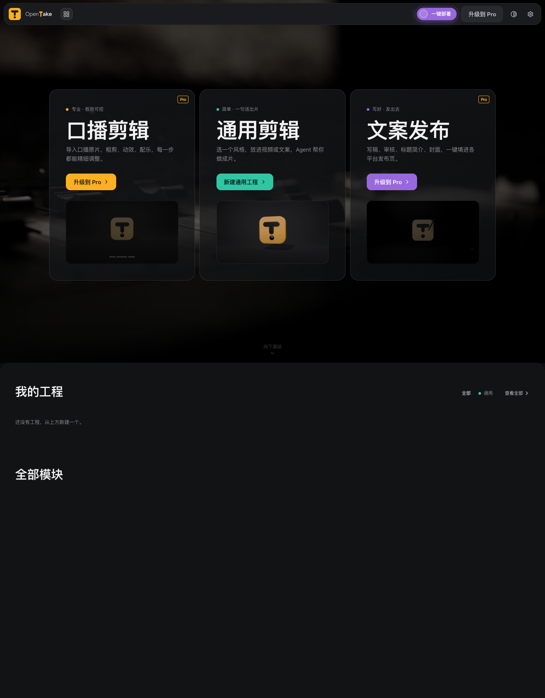
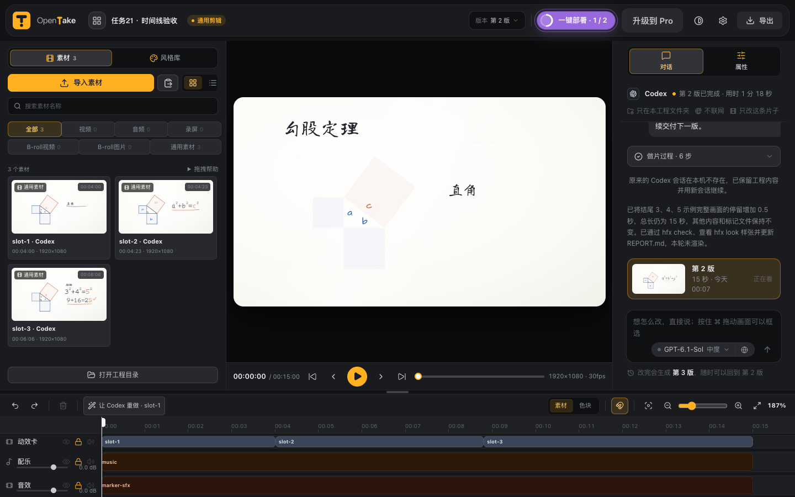
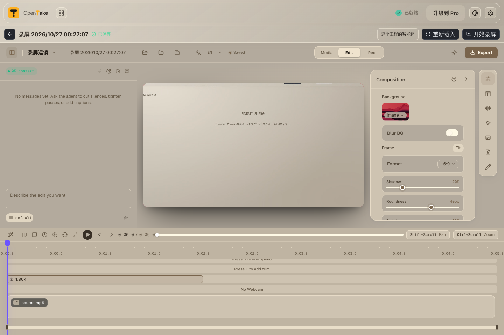

> **1.0.0 用户请对智能体说：按 AGENTS.md 更新到最新版。** 1.0.0 没有更新提醒；从 1.0.1 开始每天检查。

# OpenTake Standard

免费的本地视频工具：通用剪辑与录屏运镜。编辑不需要 OpenTake 账号；出片可接入 Codex 或 Claude Code 命令行，并支持 API 密钥方式（仍需对应命令行执行出片）；Claude Code 默认关闭。只有 API 密钥、没装命令行时只能做轻量文字任务。Pro 功能不包含在本仓库。

**[下载最新官方源码 ZIP](https://github.com/saf1102/opentake-standard/releases/latest/download/OpenTake-Standard-source.zip)** · [核对 SHA-256](https://github.com/saf1102/opentake-standard/releases/latest/download/OpenTake-Standard-source.zip.sha256) · [查看每日下载统计](https://github.com/saf1102/opentake-standard/tree/repository-stats)

这是源码，需要在自己的电脑安装依赖并构建，不是预编译安装包。推荐使用上面的官方 Release 附件；GitHub 的绿色 Code → Download ZIP 也能取源码，但那个入口没有可用下载计数。统计显示请求次数，不是用户人数或安装成功数，App 不上报使用遥测。[统计口径](DOWNLOAD-STATS.md)

## 界面预览

首页：



通用剪辑出片与时间线：



录屏运镜：



截图来源和版本见 [截图记录](screenshots/README.md)。截图不代表每种智能体都已真实出片。

## Standard 和 Pro

| 能力 | Standard | Pro |
| --- | --- | --- |
| 通用剪辑：上传视频 / 给文案 | 有 | 有 |
| 风格库 | 九类全列，五类十种可用，其余显示 Pro | 完整风格库 |
| 录屏运镜、时间线、成片导出 | 有，另装 OpenScreen | 有，另装 OpenScreen |
| 统一智能体接入 | 共用；仅显示通用剪辑、录屏相关接入 | 共用，另有创作服务接入 |
| Claude Code | 默认关，需用户启用；可用 API 密钥 | 同样默认关 |
| 口播剪辑、动效库、链接读取 | Pro 介绍入口 | 有 |
| 文案发布、选题、运营分析 | Pro 介绍入口 | 有 |
| 安装与更新 | 公开源码，本机构建 | 桌面应用与更新服务 |
| 使用账号 | 编辑不需 OpenTake 账号 | 需要授权 |

在应用中点「升级到 Pro」查看当前开放状态与申请方式。申请不会自动购买或替换本机应用。

## 智能体接入

设置 → 智能体接入，统一选择「命令行 · 账号登录」或「API 密钥」。密钥只存 macOS 钥匙串；地址与密钥仅在启动本次智能体时传入，不改 `~/.codex`、`~/.claude`。第三方接口以亮紫提醒，测试通过后可以使用。Codex API 必须兼容 OpenAI Responses，Claude Code API 必须兼容 Anthropic。

Claude Code 默认关闭。订阅账号方式开启前有风险确认，推荐 API 密钥。未适配的命令行或接口明确显示「待适配」；没有命令行的 API 接入不能出片。真实接入结果以本机「测试连接」为准；任务验收仅让 Codex 命令行真实出片；所有 API 密钥方式（包括 Codex）只检查连通，不运行任务。

## English

OpenTake Standard is a local, source-distributed video editor for general creation and screen-recording motion. Install on an Apple Silicon Mac with `npm run setup`, then open with `npm start`. Agent connections support CLI accounts and API keys; film generation requires a supported CLI. Claude Code is off by default. Pro-only publishing, talking-head and analytics modules are not included.

## 许可与隐私

源码使用 AGPL-3.0，详见 LICENSE；OpenTake 名称与图标的使用边界见 TRADEMARK.md。默认不采集使用行为，公开更新检查可在设置中关闭。工程保存在本机；使用智能体或第三方接口时，任务内容会发送给你选择的提供方。

## 安装（macOS / Apple 芯片）

对你的智能体说：**按这个仓库的 AGENTS.md 帮我装好 OpenTake Standard。**

先安装 Node.js 24.15.0 或更新的 24.x（含 npm）、Python 3 和 FFmpeg / ffprobe；setup 会准备独立 numpy 环境。生成视频还需要安装支持出片的智能体命令行，并在设置中完成接入。录屏运镜的录制和导出需要另外安装官方 OpenScreen 2.1.2 或兼容版本，见下节。不要用 sudo，也不要关闭系统安全保护。

```sh
# 将官方源码 ZIP 解压后，进入源码目录
cd opentake-standard
npm run setup
npm run typecheck
npm test
# 在设置中接通智能体以后，再检查出片环境
npm run doctor
npm start
```

也可以用 Git 获取源码：`git clone https://github.com/saf1102/opentake-standard.git`，然后进入目录执行上面的安装步骤。已有 Git 工作目录可继续按 Git 更新；ZIP 快照不会包含 Git 历史。

`setup` 适用于 macOS 12+ / Apple 芯片（锁定 Electron 的最低系统版本；实际工具检查仍须通过），需要至少 8 GB 可用空间。它检查系统和 Node、执行两次 `npm ci`、安装匹配的 Playwright Chromium，在 `~/.opentake-venv` 准备 Python + numpy，并用 `build:live` 构建。失败会用中文说明并以非零退出码结束；修好后可重复运行，已完成且依赖完整的安装会跳过。缺少 FFmpeg 时只提示，不自动下载。OpenScreen 可选，不阻断通用剪辑安装。

手动步骤仍可使用：

```sh
npm ci
npm --prefix vendor/openscreen ci --ignore-scripts
npx --no-install playwright-core install chromium
python3 -m venv "$HOME/.opentake-venv"
"$HOME/.opentake-venv/bin/python3" -m pip install numpy
npm run typecheck
npm test
npm run build:live
```

两个 `npm ci` 都是必要步骤。第二个只安装内嵌编辑器的前端构建依赖，不编译 OpenScreen 原生合成器。`npm run build` 生成录屏编辑器资源；不能只装根目录依赖就直接启动。浏览器由锁定版本的 Playwright 从官方源安装。

日后在此目录运行 `npm start` 打开桌面窗口；`npm run dev` 仅启动网页开发服务。

### 生成本机 App

完成上面的安装后运行 `npm run build:app`，在 `release/` 下得到经过本机临时签名、严格验签且已清理隔离标记的 `OpenTake Standard.app`。先在该位置双击验收，再自行拖到「应用程序」；已有同名 App 时先确认，不覆盖已有工程。此命令不生成安装包、不发布，也不包含媒体工具；FFmpeg、Python、Codex、OpenScreen 仍需在本机可用。

### 缺少工具时

- Node.js：从 [Node.js 官方站点](https://nodejs.org/) 安装 24.15.0 或更新的 24.x，重新开终端确认 `node --version`。
- FFmpeg：确认 `ffmpeg -version` 和 `ffprobe -version` 都成功。Standard 不分发 FFmpeg 二进制；请使用合适许可的构建。需要手动指定时，把含这两个程序的目录设为 `LINKREADER_BIN_DIR`。
- Python：确认 `python3 -c "import numpy"` 成功。缺 numpy 时可建立项目自己的虚拟环境：`python3 -m venv .venv`，再运行 `.venv/bin/python -m pip install numpy`；启动前将 `LINKREADER_PYTHON` 设为该解释器的绝对路径，不改系统 Python。
- Chromium：再次运行上面的 Playwright 安装命令；不要使用另一版本的缓存替代。
- OpenScreen：按下一节从官方发布页安装。没有它仍可使用通用剪辑。
- 网络失败：保留目录，网络恢复后重试失败的安装步骤。不要跳过失败步骤后声称安装完成。

测试或并行安装可显式设置 `OPENTAKE_STANDARD_USER_DATA`（配置目录）及 `LINK_READER_PROJECTS_DIR`（工程目录），都使用独立绝对路径。默认工程目录是 `~/Movies/LinkReader Projects`，卸载程序时不要删除工程目录。

## Recording and OpenScreen export

Install OpenScreen separately. Standard discovers `openscreen` on PATH, the macOS Applications folders, or an explicit `OPENSCREEN_BIN` executable. The tested official release is 2.1.2 (macOS arm64). Official 1.10.0 rejects schema v7 exports. MP4 export uses H.264 and explicitly passes the selected 24/30/60 fps. The embedded editor saves projects locally; recording and export invoke the installed OpenScreen process and its own renderer. Standard does not bundle or borrow its native compositor. Missing or incompatible installations report an error and preserve the project; no alternative renderer is used. An installation being detected is not proof of export compatibility.

Grant screen/audio recording permission to OpenScreen when macOS requests it. You can still import and edit recordings in Standard without the external App, but native export requires it. No automatic OpenScreen or native SDK downloads are performed.

## Upgrade privacy

Standard editing requires no account. Upgrade checks fetch public configuration when opening the upgrade dialog and once daily by default; disable daily checks in Settings. The public configuration request carries no account information. Upgrade sign-in stores a session only in the user data directory, never in projects or logs; passwords are not stored. The fallback is `https://raw.githubusercontent.com/saf1102/opentake-standard/main/upgrade.json`; if both sources are unavailable, the app falls back to built-in beta mode.

本机隔离验收可设置绝对路径 `OPENSCREEN_USER_DATA_DIR`。Standard 会用这个目录启动 OpenScreen，并且只扫描该目录内的 projects 和 recordings，避免导入日常录屏档案。未设置时保持 OpenScreen 的默认目录。

## 支持平台

仅支持 macOS（Apple 芯片）。Windows：适配中，暂不支持。

### FFmpeg 环境检查

安装后先运行 `npm run doctor`，也可到“关于与更新 → FFmpeg 环境检查”查看两个程序的版本和路径。必须在同一目录找到可执行的 ffmpeg 与 ffprobe。按 LINKREADER_BIN_DIR、登录 shell PATH、当前 PATH、macOS 常见安装目录依次查找。缺失时以亮紫提示具体缺项和已查目录；没有“运行工具目录”设置项。macOS 可运行 `brew install ffmpeg`。FFmpeg 由用户安装，不下载或打包进 Standard。

### macOS 出片前检查

点“开始生成”后，程序先实际检查 Python 3 + numpy、HyperFrames Chromium 的启动与页面截图、FFmpeg / ffprobe 和 Codex 登录。缺项用亮紫提示安装命令，保留输入；修好后点“重新检查”，全部通过才开始。`npm run doctor` 和“关于与更新 → 出片工具环境检查”使用同一套检查。

Python 推荐独立环境：`python3 -m venv "$HOME/.opentake-venv" && "$HOME/.opentake-venv/bin/python3" -m pip install numpy`。程序会优先检查这个环境；也可在启动前设置 `LINKREADER_PYTHON` 为自己的解释器绝对路径。检查与智能体均禁用用户 site-packages，不修改系统 Python。

Chromium：在 Standard 源码目录运行 `npx --no-install playwright-core install chromium`。默认使用当前锁定 Playwright 对应的 headless shell，服务端渲染模式在应用进程中单独检查；Codex 的本地 sandbox 命令只检查单进程样张模式（不调用模型、不消耗 token），不要求多进程渲染模式在沙盒内启动。指定路径可用 `PLAYWRIGHT_CHROMIUM_EXECUTABLE`；存在却无法启动也会拦住，不自动查找其他 App 或临时目录。

检查通过后，工程 `.opentake/bin/` 包装脚本与 `.opentake/tools.json` 固定使用本轮确认的路径；工具中途失效应报告，不让智能体安装依赖或另找程序。`build:live` 保留已打开窗口引用的旧资源。

## 常见问题：打开提示「已损坏」

只修复自己从官方 OpenTake Standard 源码构建的 App。旧版构建可能在改名后留下失效的 Electron 签名；浏览器下载带来的隔离标记会使问题显现。新版 `npm run build:app` 在装配后先清理产物扩展属性，再做本机临时签名，最后严格验签；任何一步失败都不能把产物当作安装成功。不要关闭 Gatekeeper，不用 sudo，也不要对来路不明的 App 执行修复。

在包含本修正的源码目录运行（Apple 芯片）：

```sh
npm run build:app
/usr/bin/codesign --verify --deep --strict "$PWD/release/mac-arm64/OpenTake Standard.app"
npm run doctor
```

如果只需修复本源码目录里已经生成的 App，先正常退出该 Standard App，再运行：

```sh
node desktop/sign-local-app.cjs "$PWD/release/mac-arm64/OpenTake Standard.app"
/usr/bin/codesign --verify --deep --strict "$PWD/release/mac-arm64/OpenTake Standard.app"
```

修复工具仅处理指定的 Standard App：先 `xattr -cr` 清理产物，再由 Electron 签名工具从内到外签名，最后执行 `codesign --verify --deep --strict` 并确认没有 `com.apple.quarantine`。它不修改源码、工程或系统安全策略。旧源码没有此脚本时，先取得包含修正的官方源码并重新构建，不跳过错误。`doctor` 默认检查本目录 `release/` 中的产物；检查其他明确的 Standard 测试副本可设置 `OPENTAKE_STANDARD_CHECK_APP` 为其绝对路径。

这只是本机临时签名，不是 Developer ID 签名或苹果公证；`spctl -a -vv` 的分发策略结果要单独记录，不能把清理隔离标记写成“公证通过”。安装验收仍须实际打开 App，确认没有「已损坏」提示、窗口和本机服务正常；仅 `open` 返回0不算成功。
